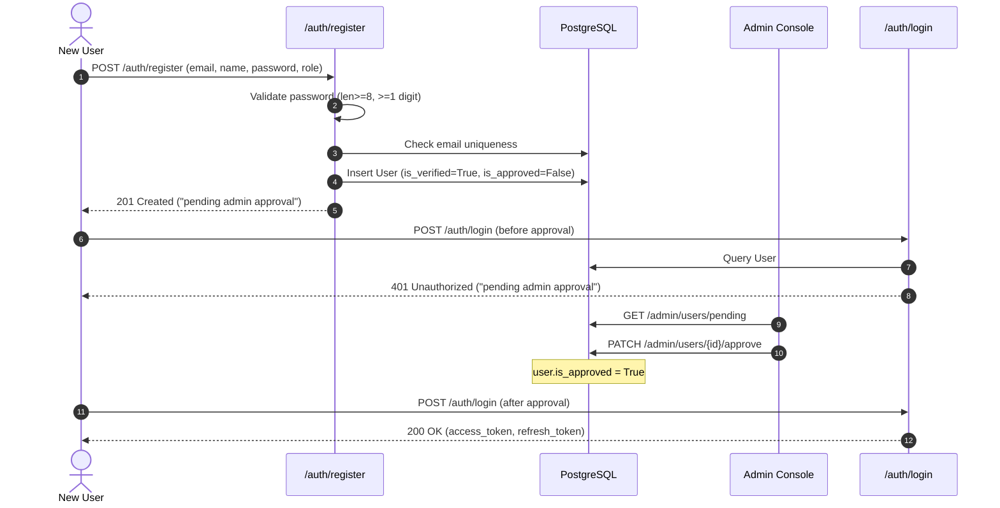

# CONTEXT PART 9: AUTH, USERS, ROLES & SECURITY
**Date:** 2026-10-17  
**Status:** COMPLETE AUDIT  
**Repository:** ProfessorOS (`backend/` and `frontend/`)  

---

## 1. Authentication Lifecycle & Endpoints

ProfessorOS implements a dual-token JWT authentication architecture (access + refresh) coupled with Argon2id password hashing, email verification, self-service registration policies, and administrative account approval gates.

### Endpoint Catalog (`backend/app/api/v1/auth.py`)

| Endpoint | Method | Role Guard | Request Schema | Response Schema | Status Code | Purpose |
|:---|:---|:---|:---|:---|:---|:---|
| `/auth/register` | `POST` | Public | [`RegisterRequest`](file:///e:/FYP_YASIN/backend/app/schemas/auth.py#L9) | [`RegisterResponse`](file:///e:/FYP_YASIN/backend/app/schemas/auth.py#L18) | `201 Created` | Self-service account registration. Hashes password, applies registration policy. |
| `/auth/login` | `POST` | Public | [`LoginRequest`](file:///e:/FYP_YASIN/backend/app/schemas/auth.py#L24) | [`TokenResponse`](file:///e:/FYP_YASIN/backend/app/schemas/auth.py#L30) | `200 OK` | Authenticates user; checks lockout, verification, suspension, and admin approval; issues access & refresh tokens. |
| `/auth/refresh` | `POST` | Public (Token) | [`RefreshRequest`](file:///e:/FYP_YASIN/backend/app/schemas/auth.py#L36) | [`TokenResponse`](file:///e:/FYP_YASIN/backend/app/schemas/auth.py#L30) | `200 OK` | Exchanges a valid refresh token for a fresh access token. |
| `/auth/logout` | `POST` | `get_current_user` | None | [`MessageResponse`](file:///e:/FYP_YASIN/backend/app/schemas/auth.py#L40) | `200 OK` | Blacklists caller's access token `jti` in Redis and invokes session revocation. |
| `/auth/verify-email` | `GET` | Public (Query) | `token: str = Query(...)` | [`MessageResponse`](file:///e:/FYP_YASIN/backend/app/schemas/auth.py#L40) | `200 OK` | Validates email token, sets `user.is_verified = True`, sends welcome email. |
| `/auth/resend-verification` | `POST` | Public | [`ResendVerificationRequest`](file:///e:/FYP_YASIN/backend/app/schemas/auth.py#L44) | [`MessageResponse`](file:///e:/FYP_YASIN/backend/app/schemas/auth.py#L40) | `200 OK` | Re-dispatches verification email with rate-limit cooldown. |
| `/auth/forgot-password` | `POST` | Public | [`ForgotPasswordRequest`](file:///e:/FYP_YASIN/backend/app/schemas/auth.py#L48) | [`MessageResponse`](file:///e:/FYP_YASIN/backend/app/schemas/auth.py#L40) | `200 OK` | Generates password reset token and dispatches reset link (silent on non-existent email). |
| `/auth/reset-password` | `POST` | Public | [`ResetPasswordRequest`](file:///e:/FYP_YASIN/backend/app/schemas/auth.py#L52) | [`MessageResponse`](file:///e:/FYP_YASIN/backend/app/schemas/auth.py#L40) | `200 OK` | Validates reset token, updates password hash, resets lockout counters, and revokes prior sessions. |

---

### Token Types, Lifetimes & Storage

| Token Type | `type` Claim | Lifetime / Expiry | Payload Contents | Backend Storage | Frontend Storage |
|:---|:---|:---|:---|:---|:---|
| **Access Token** | `"access"` | **1440 minutes (24 hours)** ([`settings.py:41`](file:///e:/FYP_YASIN/backend/app/config/settings.py#L41)) | `sub` (user_id), `role`, `type`, `iat`, `exp`, `jti` | Stateless JWT. JTI stored in Redis blacklist upon logout. | `FlutterSecureStorage` key: `'access_token'` |
| **Refresh Token** | `"refresh"` | **7 days** ([`settings.py:42`](file:///e:/FYP_YASIN/backend/app/config/settings.py#L42)) | `sub` (user_id), `type`, `iat`, `exp`, `jti` | Stateless JWT. Validated against `user.token_valid_after` and Redis blacklist. | `FlutterSecureStorage` key: `'refresh_token'` |
| **Email Verify Token** | `"verify"` | **24 hours** ([`security.py:83`](file:///e:/FYP_YASIN/backend/app/core/security.py#L83)) | `sub` (email), `type`, `iat`, `exp`, `jti` | Stateless JWT. | URL query parameter `?token=...` |
| **Password Reset Token**| `"reset"` | **24 hours** ([`security.py:83`](file:///e:/FYP_YASIN/backend/app/core/security.py#L83)) | `sub` (email), `type`, `iat`, `exp`, `jti` | Stateless JWT. | URL query parameter `?token=...` |

> [!WARNING]
> **Access Token Lifetime Risk**: `ACCESS_TOKEN_EXPIRE_MINUTES` defaults to **1440 minutes (24 hours)** in [`backend/app/config/settings.py:41`](file:///e:/FYP_YASIN/backend/app/config/settings.py#L41). A leaked access token remains valid for a full day unless an explicit session revocation or logout blacklist entry occurs.

---

### Token Revocation & Session Management

ProfessorOS implements a two-tier revocation model:
1. **Per-Token Blacklisting via Redis / In-Memory Cache**:
   - On `POST /auth/logout` ([`auth.py:118-121`](file:///e:/FYP_YASIN/backend/app/api/v1/auth.py#L118-L121)), the access token's `jti` UUID is extracted and passed to `blacklist_token(jti, ttl_seconds=3600)` ([`cache_service.py:71-82`](file:///e:/FYP_YASIN/backend/app/services/cache_service.py#L71-L82)).
   - In [`dependencies.py:43-50`](file:///e:/FYP_YASIN/backend/app/core/dependencies.py#L43-L50), `get_current_user` checks `is_token_blacklisted(jti)`. If found, it immediately aborts with `HTTP 401 Unauthorized: Token has been revoked`.
2. **Global Session Revocation via Database Timestamp**:
   - `User` model includes `token_valid_after: Mapped[Optional[datetime]]` ([`user.py:43`](file:///e:/FYP_YASIN/backend/app/models/user.py#L43)).
   - When a user changes password ([`auth_service.py:207`](file:///e:/FYP_YASIN/backend/app/services/auth_service.py#L207)), calls `DELETE /users/me/sessions` ([`users.py:108-116`](file:///e:/FYP_YASIN/backend/app/api/v1/users.py#L108-L116)), or an admin resets their password, `AuthService.revoke_all_sessions(user_id)` sets `user.token_valid_after = datetime.now(timezone.utc)`.
   - On every authenticated request ([`dependencies.py:72-86`](file:///e:/FYP_YASIN/backend/app/core/dependencies.py#L72-L86)) and refresh call ([`auth_service.py:151-159`](file:///e:/FYP_YASIN/backend/app/services/auth_service.py#L151-L159)), the token's issued-at timestamp (`iat`) is evaluated against `user.token_valid_after`. If `token.iat < user.token_valid_after`, the token is rejected with `HTTP 401 Unauthorized: Session has been revoked. Please sign in again`.

---

### Registration & Admin Approval Flow

Self-service registration logic is governed by [`backend/app/services/registration_policy.py:4-5`](file:///e:/FYP_YASIN/backend/app/services/registration_policy.py#L4-L5):
```python
def registration_flags(role: str) -> dict[str, bool]:
    return {"is_verified": True, "needs_approval": role in ("professor", "student", "ta")}
```



> [!NOTE]
> **Email Verification Bypass**: Because `registration_policy.py` sets `"is_verified": True` by default for all roles, verification emails are **not** dispatched during regular registration. All self-registered users (`professor`, `student`, `ta`) bypass email verification and are routed directly to the administrative approval queue (`is_approved = False`).

---

## 2. Roles & Authorization Permission Matrix

ProfessorOS defines four explicit user roles in [`backend/app/models/user.py:14-19`](file:///e:/FYP_YASIN/backend/app/models/user.py#L14-L19):
- `UserRole.ADMIN = "admin"`
- `UserRole.PROFESSOR = "professor"`
- `UserRole.TA = "ta"`
- `UserRole.STUDENT = "student"`

### Permission Matrix Across Key System Endpoints

| Area / Action | Endpoint | Admin | Professor | TA | Student | Enforcing Code & Mechanism |
|:---|:---|:---:|:---:|:---:|:---:|:---|
| **View Profile** | `GET /users/me` | ✅ | ✅ | ✅ | ✅ | `Depends(get_current_user)` ([`users.py:47`](file:///e:/FYP_YASIN/backend/app/api/v1/users.py#L47)) |
| **Student Dashboard** | `GET /users/me/student-dashboard` | ❌ | ❌ | ❌ | ✅ | `require_roles("student")` ([`users.py:54`](file:///e:/FYP_YASIN/backend/app/api/v1/users.py#L54)) |
| **User Administration** | `GET /admin/users` | ✅ | ❌ | ❌ | ❌ | `require_roles("admin")` ([`users.py:123`](file:///e:/FYP_YASIN/backend/app/api/v1/users.py#L123)) |
| **Approve / Reject Users**| `PATCH /admin/users/{id}/approve` | ✅ | ❌ | ❌ | ❌ | `require_roles("admin")` ([`users.py:265`](file:///e:/FYP_YASIN/backend/app/api/v1/users.py#L265)) |
| **Batch CSV Import** | `POST /admin/users/import` | ✅ | ❌ | ❌ | ❌ | `require_roles("admin")` ([`users.py:140`](file:///e:/FYP_YASIN/backend/app/api/v1/users.py#L140)) |
| **Create Course** | `POST /courses` | ✅ | ✅ | ❌ | ❌ | `require_roles("professor", "admin")` ([`courses.py:32`](file:///e:/FYP_YASIN/backend/app/api/v1/courses.py#L32)) |
| **List Courses** | `GET /courses` | ✅ (All) | ✅ (Owned) | ✅ (Enrolled) | ✅ (Enrolled) | Scoped procedurally in `CourseService.list_courses()` ([`courses.py:53`](file:///e:/FYP_YASIN/backend/app/api/v1/courses.py#L53)) |
| **Join Course via Code**| `POST /courses/join` | ❌ | ❌ | ❌ | ✅ | `require_roles("student")` ([`courses.py:112`](file:///e:/FYP_YASIN/backend/app/api/v1/courses.py#L112)) |
| **Manage Course Roster**| `POST /courses/{id}/enroll` | ✅ | ✅ (Owner) | ❌ (Bug) | ❌ | `verify_course_management_access()` strictly asserts `professor` or `admin` ([`course_service.py:114`](file:///e:/FYP_YASIN/backend/app/services/course_service.py#L114)) |
| **Create Assignment** | `POST /courses/{id}/assignments` | ✅ | ✅ (Owner) | ❌ (Bug) | ❌ | Route accepts `ta`, but `verify_course_management_access` blocks TAs with 403 ([`assignments.py:32`](file:///e:/FYP_YASIN/backend/app/api/v1/assignments.py#L32)) |
| **Edit Assignment Settings** | `PUT /courses/{id}/assignments/{aid}` | ✅ | ✅ (Owner) | ❌ (Bug) | ❌ | Route accepts `ta`, but `verify_course_management_access` blocks TAs with 403 ([`assignments.py:85`](file:///e:/FYP_YASIN/backend/app/api/v1/assignments.py#L85)) |
| **Lock Exam Settings** | `PUT /courses/{id}/assignments/{aid}/exam/settings` | ✅ | ✅ (Owner) | ❌ | ❌ | `require_roles("professor", "admin")` + attempt check ([`exams.py:1016`](file:///e:/FYP_YASIN/backend/app/api/v1/exams.py#L1016)) |
| **Start Proctored Exam** | `POST /courses/{id}/assignments/{aid}/exam/start` | ❌ | ❌ | ❌ | ✅ | `require_roles("student")` + enrollment validation ([`exams.py:350`](file:///e:/FYP_YASIN/backend/app/api/v1/exams.py#L350)) |
| **Submit Exam Telemetry** | `POST /attempts/{id}/violations` | ❌ | ❌ | ❌ | ✅ | `require_roles("student")` + `attempt.student_id == user.id` ([`exams.py:438`](file:///e:/FYP_YASIN/backend/app/api/v1/exams.py#L438)) |
| **Exam Proctor Decision** | `POST /courses/{id}/assignments/{aid}/attempts/{atid}/decision` | ✅ | ✅ (Owner) | ❌ (Bug) | ❌ | Route accepts `ta`, but `verify_course_management_access` rejects TAs with 403 ([`exams.py:847`](file:///e:/FYP_YASIN/backend/app/api/v1/exams.py#L847)) |
| **Global Analytics** | `GET /analytics/system` | ✅ | ❌ | ❌ | ❌ | `require_roles("admin")` ([`analytics.py:42`](file:///e:/FYP_YASIN/backend/app/api/v1/analytics.py#L42)) |

---

## 3. Cryptography, Rate Limiting & Network Hardening

### Password Hashing (Argon2id)
Passwords are encrypted using Argon2id via `argon2-cffi` in [`backend/app/core/security.py:15-35`](file:///e:/FYP_YASIN/backend/app/core/security.py#L15-L35):
```python
_ph = PasswordHasher(
    time_cost=2,
    memory_cost=65536,  # 64 MB
    parallelism=1,
    hash_len=32,
    salt_len=16,
    type=Type.ID,       # Argon2id
)
```
Password verification runs in an off-thread executor (`asyncio.to_thread(verify_password, ...)`) in [`auth_service.py:102`](file:///e:/FYP_YASIN/backend/app/services/auth_service.py#L102) to prevent blocking FastAPI's async event loop.

### Account Lockout & Throttling
1. **Database Lockout (Persistent)**:
   - Evaluated in `AuthService.login()` ([`auth_service.py:104-118`](file:///e:/FYP_YASIN/backend/app/services/auth_service.py#L104-L118)).
   - Each failed password attempt increments `user.failed_attempts`.
   - Reaching `MAX_LOGIN_ATTEMPTS = 5` ([`settings.py:43`](file:///e:/FYP_YASIN/backend/app/config/settings.py#L43)) sets `user.locked_until = now + 15 minutes` ([`settings.py:44`](file:///e:/FYP_YASIN/backend/app/config/settings.py#L44)).
   - Login attempts during lockout fail immediately with remaining time.
2. **IP & Email Rate Limiting (Redis / In-Memory)**:
   - Evaluated in `POST /auth/login` ([`auth.py:78`](file:///e:/FYP_YASIN/backend/app/api/v1/auth.py#L78)) via `allow_login_attempt(identity)` ([`cache_service.py:105-135`](file:///e:/FYP_YASIN/backend/app/services/cache_service.py#L105-L135)).
   - Limits: **10 login attempts per 60 seconds** per client IP and per email.
   - Uses Redis key `login-limit:<sha256(identity)>` with in-memory dictionary fallback.
3. **Email Endpoint Throttling**:
   - `_check_email_rate_limit(email)` ([`auth.py:27-38`](file:///e:/FYP_YASIN/backend/app/api/v1/auth.py#L27-L38)) enforces a strict **1 request per 60 seconds** cooldown for `/forgot-password` and `/resend-verification`.

### CORS & Security Headers
Configured in [`backend/app/main.py:45-70`](file:///e:/FYP_YASIN/backend/app/main.py#L45-L70):
```python
# CORS Middleware
app.add_middleware(
    CORSMiddleware,
    allow_origins=_origins,  # Parsed from ALLOWED_ORIGINS env var
    allow_credentials=True,
    allow_methods=["*"],
    allow_headers=["*"],
)

# HTTP Security Headers Middleware
@app.middleware("http")
async def add_security_headers(request, call_next):
    response = await call_next(request)
    response.headers.setdefault("X-Content-Type-Options", "nosniff")
    response.headers.setdefault("X-Frame-Options", "DENY")
    response.headers.setdefault("Referrer-Policy", "no-referrer")
    response.headers.setdefault("Permissions-Policy", "camera=(), microphone=(), geolocation=()")
    if _settings.ENVIRONMENT.lower() == "production" and request.url.scheme == "https":
        response.headers.setdefault("Strict-Transport-Security", "max-age=31536000; includeSubDomains")
    return response
```

> [!IMPORTANT]
> **Permissions-Policy Conflict**: The security header sets `Permissions-Policy: camera=(), microphone=(), geolocation=()`. This explicitly denies camera and microphone access to the entire web origin. Any future attempt to implement browser-based webcam proctoring or audio monitoring will be blocked by the browser at the HTTP header level.

---

## 4. The Biometric Gate: Architecture & Privacy Audit

The codebase references "biometrics" across two separate user journeys:

### Journey A: Biometric Quick-Login (Mobile / Native App)
- **Files:** [`frontend/lib/core/network/dio_client.dart:42-59`](file:///e:/FYP_YASIN/frontend/lib/core/network/dio_client.dart#L42-L59), [`frontend/lib/features/auth/presentation/login_screen.dart:37-65`](file:///e:/FYP_YASIN/frontend/lib/features/auth/presentation/login_screen.dart#L37-L65).
- **Mechanism:** When a user logs in, the app optionally saves credentials:
  ```dart
  await _storage.write(key: 'biometric_email', value: email);
  await _storage.write(key: 'biometric_password', value: password);
  ```
- **Login Flow:** Tapping "Sign in with Biometrics" triggers Flutter's `local_auth` plugin (`_localAuth.authenticate(...)`). If device authentication passes, it reads the plaintext email and password from `FlutterSecureStorage` and performs a standard `POST /auth/login`.

### Journey B: Pre-Exam Biometric Verification Gate
- **File:** [`frontend/lib/features/courses/presentation/exam_screen.dart:265-325`](file:///e:/FYP_YASIN/frontend/lib/features/courses/presentation/exam_screen.dart#L265-L325).
- **Mechanism:** Before revealing exam questions, the screen triggers:
  ```dart
  final canCheck = await _localAuth.canCheckBiometrics;
  if (!canCheck) {
    if (mounted) setState(() => _biometricPassed = true);
    return;
  }
  ```
- **Fallback:** If biometrics fail twice (`_biometricFailures >= 2`), it shows a password fallback dialog ([`exam_screen.dart:283`](file:///e:/FYP_YASIN/frontend/lib/features/courses/presentation/exam_screen.dart#L283)).

### Privacy & Architecture Reality
1. **Server Storage / Transmission**: **ZERO**. The backend has no biometric models, no database columns, no endpoints, and receives no biometric payloads. The verification is entirely client-side.
2. **Web / Desktop Bypass**: In a standard desktop web browser, `_localAuth.canCheckBiometrics` returns `false`. The code immediately sets `_biometricPassed = true; return;`. The biometric gate silently auto-bypasses on desktop without student interaction.
3. **Credential Storage Risk**: Plaintext student passwords remain in device secure storage indefinitely (explicitly preserved during `clearTokens()` in [`dio_client.dart:38`](file:///e:/FYP_YASIN/frontend/lib/core/network/dio_client.dart#L38)).

---

## 5. User Import (CSV) & Management Screens

### Batch CSV Import Pipeline ([`backend/app/services/user_service.py:58-112`](file:///e:/FYP_YASIN/backend/app/services/user_service.py#L58-L112))
- **Route:** `POST /admin/users/import` ([`users.py:138`](file:///e:/FYP_YASIN/backend/app/api/v1/users.py#L138)).
- **Max File Size:** 5 MB (`MAX_USER_CSV_BYTES = 5 * 1024 * 1024`, [`users.py:28`](file:///e:/FYP_YASIN/backend/app/api/v1/users.py#L28)).
- **Expected Columns:** `email`, `full_name`, `role`, `password`.
- **Validation Rules:**
  - `email`: required, converted to lowercase, uniqueness checked.
  - `full_name`: required.
  - `password`: required, minimum 8 characters.
  - `role`: must be one of `("professor", "student", "ta", "admin")`.
- **Status Assignment:**
  ```python
  user = User(
      email=email,
      full_name=full_name,
      hashed_password=await asyncio.to_thread(hash_password, password),
      role=role,
      is_verified=True,  # CSV imports are pre-verified
      is_active=True,
      # is_approved defaults to True in the User model!
  )
  ```
  CSV-imported staff members (professors and TAs) are **automatically approved** and can immediately sign in.

### Administrative Frontend Screens
1. **Admin Dashboard Screen** ([`frontend/lib/features/admin/presentation/admin_dashboard_screen.dart`](file:///e:/FYP_YASIN/frontend/lib/features/admin/presentation/admin_dashboard_screen.dart)):
   - High-level KPIs: Total Users, Active Courses, Pending Approvals, System Storage.
   - Quick links to User Management, Course Audits, and OBE Analytics.
2. **User Management Screen** ([`frontend/lib/features/admin/presentation/user_management_screen.dart`](file:///e:/FYP_YASIN/frontend/lib/features/admin/presentation/user_management_screen.dart), 702 lines):
   - Search & Role Filter Tabs: `All`, `Professor`, `Student`, `TA`, `Admin`.
   - Paginated data table with status badges (`Active`, `Suspended`, `Pending`).
   - Actions: Edit Role, Suspend/Activate, Reset Password, Delete User.
   - Floating Actions: "Import CSV" and "Add User" modals.
3. **Pending Approvals Tab**:
   - Lists users where `is_approved == False`.
   - Dedicated "Approve" and "Reject" buttons with reason modals.
4. **User Profile Screen** ([`frontend/lib/features/profile/presentation/profile_screen.dart`](file:///e:/FYP_YASIN/frontend/lib/features/profile/presentation/profile_screen.dart), 868 lines):
   - Edit full name (`PUT /users/me`).
   - Change password (`PUT /users/me/password`).
   - "Sign Out All Devices" (`DELETE /users/me/sessions`).
   - Theme toggle (Dark / Light / System).
